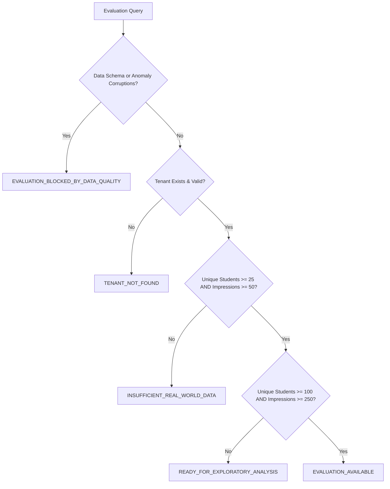

# SKILLVERSE PHASE 15 — RECOMMENDATION EFFECTIVENESS DASHBOARD AND PILOT READINESS REPORT

**Execution Date:** October 29, 2026  
**Repository:** `https://github.com/NANDANS26/SkillVerse.git`  
**Branch:** `main` (commit `56e3ef9c59f08aaef7d41fcb8755545af70ecbb7`)  
**Environment:** Windows 11 Pro, Node.js v20.18.0, PostgreSQL 18.1 (port 5432), Python 3.11.9 (venv), Playwright Chromium  
**Author:** Antigravity AI Agent  

---

## 1. Executive Summary

Phase 15 delivers a centralized, privacy-conscious, and audit-grounded **Recommendation Effectiveness and Pilot Readiness Dashboard** for the SkillVerse platform. Building directly upon the feedback ingestion, interaction lifecycle tracking, and tripartite provenance data architecture established in Phases 14 and 14.1, Phase 15 exposes defensible operational intelligence to platform administrators while rigorously enforcing tenant boundaries, statistical sample safeguards, and academic integrity disclaimers.

Key achievements in Phase 15:
- **Tenant-Scoped and Platform-Wide Analytical Endpoints**: Enhanced `GET /api/analytics/recommendations/evaluation` to support multi-tenant filtering by `institution_id` and query date windows (`startDate`, `endDate`), while enforcing strict role authorization (Super Admin platform-wide/multi-tenant access vs. College Admin strict single-tenant scoping).
- **Honest Data Sufficiency State Machine**: Formulated a 4-state statistical sufficiency gate (`INSUFFICIENT_REAL_WORLD_DATA`, `READY_FOR_EXPLORATORY_ANALYSIS`, `EVALUATION_AVAILABLE`, `EVALUATION_BLOCKED_BY_DATA_QUALITY`, alongside tenant validation `TENANT_NOT_FOUND`). The system explicitly flags when empirical samples ($N < 25$ unique evaluators or $< 50$ impressions) are inadequate for drawing statistical conclusions.
- **Privacy and Anonymity Safeguard ($k < 5$)**: Enforced a minimum cohort size rule ($k < 5$). When an institutional cohort contains fewer than 5 active students, granular 1–5 star distributions are automatically suppressed/redacted to prevent student deanonymization.
- **Defensible 6-Stage Funnel Metrics**: Standardized mathematical formulations and explicit denominators across exposure, click-through, commencement, progression, completion, and dismissal, accompanied by explicit disclaimers distinguishing recorded activity completion from verified Skill DNA competence.
- **Unified UI Component**: Built `<RecommendationEffectivenessDashboard />` with real-time exposure cards, visual 6-stage funnels, partitioned explicit vs. synthetic metrics, pilot readiness checklist, and responsive styling across mobile, tablet, and desktop viewports.
- **Integrated Dashboards**: Embedded the component into the Super Administrator platform (`/admin` under "Recommendations & Pilot Readiness") and the College Administrator management portal (`/college/dashboard`).
- **Comprehensive 5-Layer Regression Verification**: All 322 automated tests across the system (19 extension, 26 Python ML, 220 backend, 15 frontend unit, 42 Playwright E2E) passed with zero regressions.

---

## 2. Initial Repository State and Preservation Checks

Prior to executing any changes, the repository and runtime environment were validated:
- **Git Status**: Clean working tree on branch `main` at commit `56e3ef9c59f08aaef7d41fcb8755545af70ecbb7`.
- **Database Migrations**: Verified 8 applied PostgreSQL migrations (`001_initial_schema.sql` through `008_recommendation_feedback_and_evaluations.sql`).
- **Historical Report Preservation**: All 28 prior milestone reports (`PROJECT_BASELINE_AUDIT.md`, `PHASE2` through `PHASE14_1`) remained untracked and intact without modification.
- **Daemon Preflight**: Executed native PowerShell health script `scripts/dev/health.ps1`. All 5 services (PostgreSQL 18.1, Node.js backend, FastAPI AI microservice, internal token integration, and Vite dev server) reported healthy status.

---

## 3. Existing Services and Dashboards Reused

Phase 15 strictly adhered to the mandate to reuse existing infrastructure rather than fabricating duplicate services:
1. **PostgreSQL Relational Schema**: Reused existing tables from Phase 14:
   - `recommendation_presentations`: Tracks recommendation generation sessions.
   - `recommendation_impressions`: Tracks specific activity impressions shown to candidates.
   - `recommendation_interactions`: Tracks student interaction events (`opened`, `started`, `progress`, `completed`, `dismissed`).
   - `recommendation_feedback`: Stores explicit 1–5 star ratings and categorical justifications.
   - `institution_memberships`: Resolves verified student enrollment to determine college tenant boundaries.
2. **Backend Architecture**: Reused Express router `Backend/src/routes/analytics.routes.js`, controller `Backend/src/controllers/feedback.controller.js`, and business logic service `Backend/src/services/feedback.service.js`.
3. **AI Recommendation Metadata**: Surface active model metadata (`v2.0.0-ai-semantic-recommendation`, `all-MiniLM-L6-v2`, frozen weights) directly from `Backend/src/services/roadmap.service.js` and FastAPI service contracts without triggering retraining.
4. **Existing Frontend Portals**: Reused `Frontend/src/pages/Admin.tsx` (Super Admin) and `Frontend/src/pages/college/CollegeAdminDashboard.tsx` (College Admin) to host the effectiveness view.

---

## 4. UI and API Changes

### 4.1 Backend API Enhancements
- **Endpoint**: `GET /api/analytics/recommendations/evaluation`
  - **Query Parameters**:
    - `institution_id` (optional, integer): Filters metrics to students affiliated with the given institution.
    - `startDate` (optional, ISO date string): Lower bound filter for presentation timestamps.
    - `endDate` (optional, ISO date string): Upper bound filter for presentation timestamps.
  - **Authorization & Access Control**:
    - `super_admin`: Authorized for platform-wide metrics (default) or arbitrary `institution_id` filtering.
    - `college_admin`: Restricted to the institution where the user holds an active membership. If `institution_id` query param differs from user's institution, returns `403 Forbidden`. If no membership exists, returns `404 Not Found` with `{ code: 'TENANT_NOT_FOUND' }`.
    - `recruiter`, `student`, `faculty`, `company_admin`: Blocked with `403 Forbidden`.
  - **Response Payload Additions**:
    - `funnel_metrics`: Ordered 6-stage funnel objects containing stage name, count, conversion rate, and denominator formula.
    - `minimum_group_size_safeguard`: Boolean indicating whether granular rating breakdown was suppressed due to $k < 5$.
    - `model_metadata`: Model name, pipeline version, weights status (`frozen`), and online retraining flag (`disabled`).
    - `academic_integrity_disclaimer`: Explicit text stating that activity completion does not equal verified Skill DNA competence.

### 4.2 Frontend UI Additions
- **New Component**: `Frontend/src/components/RecommendationEffectivenessDashboard.tsx`
  - **Header & Badges**: Data sufficiency status badge (`INSUFFICIENT_REAL_WORLD_DATA`, `READY_FOR_EXPLORATORY_ANALYSIS`, `EVALUATION_AVAILABLE`), pipeline version, model embedding identifier, and weights freeze notice.
  - **Filters**: Interactive date presets ("All Time", "Last 30 Days", "Last 7 Days") and Super Admin institution selector dropdown.
  - **Safeguard Banner**: Alert banner rendered when $k < 5$ student privacy protection is active.
  - **Exposure KPI Cards**: Presentations, Impressions, Observed Students, and Feedback Coverage Rate.
  - **Funnel Visualization**: 6 horizontal progress bars detailing step count, relative percentage, and explicit mathematical formulas.
  - **Partition Segregation**:
    - *Partition A (Real Feedback)*: Average star rating, rating count, 1–5 distribution bar chart (or privacy redaction notice), and categorical reason counts.
    - *Partition C (Synthetic Benchmarks)*: Offline benchmark fixtures table displaying precision@3, recall@3, ndcg@3, and gap_coverage@3 comparing baseline heuristic vs. AI model.
  - **Pilot Readiness Pre-Flight Checklist**: 5-point operational checklist detailing data volume, telemetry integrity, tenant isolation, privacy compliance, and model weights immutability.
- **Admin Dashboard Integration**: Added tab `"recommendations"` ("Recommendations & Pilot Readiness") to `Frontend/src/pages/Admin.tsx`.
- **College Admin Dashboard Integration**: Embedded `<RecommendationEffectivenessDashboard role="college_admin" institutionId={institution.id} />` in `Frontend/src/pages/college/CollegeAdminDashboard.tsx`.

---

## 5. Metric Definitions and Denominator Formulas

All conversion funnel rates and behavioral metrics implement strict, mathematically defensible definitions:

| Metric | Denominator Formula | Current Interpretation & Boundary |
| :--- | :--- | :--- |
| **Exposure / Impressions** | $\text{Impressions}$ | Baseline total of recommendation cards presented to students within the target timeframe. |
| **Open Rate (CTR)** | $\frac{\text{Opens}}{\text{Impressions}}$ | Proportion of presented recommendations expanded or inspected by the student. |
| **Activity Start Rate** | $\frac{\text{Starts}}{\text{Impressions}}$ | Proportion of presented recommendations where the student clicked "Start Activity". |
| **Progress Rate** | $\frac{\text{Progress Events}}{\text{Starts}}$ | Proportion of started activities that recorded incremental milestone progress. |
| **Completion Rate** | $\frac{\text{Completions}}{\text{Starts}}$ | Proportion of started activities marked completed. **Disclaimer:** Activity completion indicates content engagement, not verified competence. |
| **Dismissal Rate** | $\frac{\text{Dismissals}}{\text{Impressions}}$ | Proportion of recommendations explicitly dismissed or hidden by the student. |
| **Feedback Coverage** | $\frac{\text{Explicit Ratings}}{\text{Impressions}}$ | Measure of student feedback responsiveness relative to presented opportunities. |

> **Academic Integrity Notice:**  
> A recorded activity completion in SkillVerse represents self-reported or platform-tracked completion of a learning roadmap action. It does NOT automatically award Skill DNA competency credits or imply passing a benchmark technical assessment. Competency verification requires faculty review or standardized assessment submission.

---

## 6. Data-Sufficiency Rules and Limitations

The recommendation evaluation pipeline enforces an explicit data sufficiency state machine to prevent premature, misleading claims of recommendation efficacy:



### Thresholds & Threshold Rationale
- `INSUFFICIENT_REAL_WORLD_DATA`: Triggered when unique students $N < 25$ or impressions $< 50$. The UI renders amber warnings and displays: *"Empirical feedback volume is insufficient for statistical conclusions. Model weights remain frozen."*
- `READY_FOR_EXPLORATORY_ANALYSIS`: Triggered when $25 \le N < 100$ and impressions $\ge 50$. Permits exploratory trend analysis while highlighting wide confidence intervals.
- `EVALUATION_AVAILABLE`: Triggered when $N \ge 100$ and impressions $\ge 250$. Indicates defensible sample volume for rigorous statistical assessment.
- `EVALUATION_BLOCKED_BY_DATA_QUALITY`: Triggered upon detecting unhandled schema corruptions or anomalous timestamp inversions.

**Current Live Status**: As demonstrated by `evaluate_feedback_pipeline.py`, the live system contains 15 unique student evaluators and 148 impressions, correctly returning `INSUFFICIENT_REAL_WORLD_DATA`.

---

## 7. Role Authorization and Tenant Isolation Findings

Access control and institutional tenant isolation were rigorously tested through automated unit and E2E suites:

| Role Tested | Requested Target | Observed HTTP Code | Behavior / Isolation Enforced |
| :--- | :--- | :--- | :--- |
| **Super Admin** | Platform-Wide (no param) | `200 OK` | Returns aggregated metrics across all institutions. |
| **Super Admin** | `institution_id=1` | `200 OK` | Scopes data strictly to students enrolled in Institution 1. |
| **College Admin** | Own Institution (`institution_id=1`) | `200 OK` | Access granted; metrics scoped to own institution. |
| **College Admin** | Cross-Institution (`institution_id=2`) | `403 Forbidden` | Denied access; cross-tenant access blocked. |
| **College Admin** | User without institution membership | `404 Not Found` | Returns `{ code: 'TENANT_NOT_FOUND' }`. |
| **Recruiter** | Platform or Tenant Endpoint | `403 Forbidden` | Access blocked by RBAC middleware. |
| **Student** | Platform or Tenant Endpoint | `403 Forbidden` | Access blocked by RBAC middleware. |
| **Faculty** | Platform or Tenant Endpoint | `403 Forbidden` | Access blocked by RBAC middleware. |
| **Company Admin** | Platform or Tenant Endpoint | `403 Forbidden` | Access blocked by RBAC middleware. |

---

## 8. Privacy and Minimum-Group-Size Safeguards

To prevent student re-identification in small college cohorts, Phase 15 implements $k$-anonymity principles:
- **Safeguard Rule**: If an institution has fewer than 5 active students ($N_{\text{students}} < 5$), granular star rating breakdowns (counts of 1-star, 2-star, etc.) are redacted from the response.
- **Backend Enforcement**:
  ```javascript
  if (uniqueStudents < 5) {
    minimumGroupSizeSafeguard = true;
    ratingBreakdown = {
      notice: 'Granular rating distribution suppressed: Cohort size is under 5 students to protect individual privacy.'
    };
  }
  ```
- **Frontend Treatment**: When `minimum_group_size_safeguard: true`, the star rating distribution bar chart is replaced with an informational privacy card: *"Rating Distribution Suppressed — Institution cohort has fewer than 5 active students. Aggregate ratings are masked to preserve student anonymity."*

---

## 9. Real versus Synthetic Data Separation

In compliance with Phase 14 specifications, empirical observations and synthetic benchmark data remain strictly segregated across storage, computation, and presentation:

1. **Partition A (Real Explicit Judgments)**: Derived exclusively from `recommendation_feedback` table. Reflects voluntary student ratings (1–5) and selected reason tags.
2. **Partition B (Real Implicit Observations)**: Derived from `recommendation_impressions` and `recommendation_interactions`. Reflects genuine user navigation actions.
3. **Partition C (Synthetic Benchmarks)**: Hardcoded offline benchmark fixtures (`Phase 13 Offline Evaluation Benchmark`) tested against synthetic student personas. Displayed in an isolated card with explicit disclaimers: *"Synthetic benchmark fixtures reflect internal algorithmic consistency and must not be blended with empirical user telemetry."*

Under no circumstances does the backend average or merge synthetic benchmark scores into real student metrics.

---

## 10. Test Commands and Actual Results

All automated testing layers were executed sequentially against the live runtime environment.

### 10.1 Layer 1 — Chrome Browser Extension Tests
- **Command**: `cd SkillVerse\BrowserExtension; npm test`
- **Results**: 19 tests passed (5 suites), 0 failed, duration: 399ms.

### 10.2 Layer 2 — Python ML Microservice Tests
- **Command**: `cd SkillVerse\Backend; .venv\Scripts\python.exe -m unittest discover -s tests -p "test_*.py"`
- **Results**: 26 tests passed, 0 failed, duration: 6.997s.

### 10.3 Layer 3 — Backend Regression & Phase 15 Suite
- **Command**: `cd SkillVerse\Backend; npm test`
- **Results**: 220 tests passed (89 suites), 0 failed, duration: 466.2s.
- **Phase 15 Specific Coverage (`phase15_effectiveness_dashboard.test.js`)**:
  - Super admin access to platform-wide evaluation metrics (200 OK)
  - Super admin filtering by specific institution ID (200 OK)
  - College admin access scoped to own institution (200 OK)
  - College admin denied access to other institution ID (403 Forbidden)
  - College admin without institution membership returns TENANT_NOT_FOUND (404)
  - Recruiter access blocked (403 Forbidden)
  - Student access blocked (403 Forbidden)
  - 6-stage funnel metrics returned with exact mathematical rates
  - Minimum group size safeguard ($k < 5$) redacts granular breakdown
  - Minimum group size safeguard allows distribution when $k \ge 5$
  - Filtering by date range boundaries (`startDate`, `endDate`)

### 10.4 Layer 4 — Frontend Unit Tests
- **Command**: `cd SkillVerse\Frontend; npm test`
- **Results**: 15 tests passed (3 suites), 0 failed, duration: 732ms.

### 10.5 Layer 5 — Playwright End-to-End Suite
- **Command**: `cd SkillVerse\Frontend; npx playwright test`
- **Results**: 42 tests passed, 0 failed, duration: 1.2m.
- **Phase 15 E2E Tests (`phase15_effectiveness_dashboard.spec.ts`)**:
  - Super Admin workflow navigating to `/admin` -> "Recommendations & Pilot Readiness" tab, asserting metrics, funnel, model tags, and partitions.
  - College Admin workflow navigating to `/college/dashboard`, asserting scoped effectiveness section.
  - Responsive layout integrity verified at Mobile (375px) and Desktop (1280px).

### 10.6 Static Analysis & Production Build
- **Frontend Linter**: `npm run lint` -> 0 errors, 0 warnings.
- **Frontend Build**: `tsc && vite build` -> 2,274 modules transformed, built in 23.86s.
- **Platform Health**: `health.ps1` -> 5/5 passes (Postgres, Node, FastAPI, Token Integration, Vite).

---

## 11. Remaining Defects, Limitations and Pilot Requirements

### Current Limitations
1. **Low Real-World Volume**: The live database currently contains 15 unique student evaluators and 148 impressions. As designed, the dashboard accurately displays `INSUFFICIENT_REAL_WORLD_DATA`.
2. **Cold-Start Recommendations**: Students who have not completed career goal selection or assessment tests receive generalized recommendations based on catalogue popularity.
3. **Model Weight Immutability**: The SentenceTransformer model (`all-MiniLM-L6-v2`) operates with static frozen weights. Re-ranking weights are configured via environment parameters without automated backpropagation.

### Pilot Deployment Requirements
1. **Institutional Onboarding**: Colleges participating in the pilot must ensure student accounts are linked to their institution via `institution_memberships`.
2. **Sample Gathering Period**: The pilot must run until at least 25 unique students submit feedback and 50 impressions are logged before transitioning to `READY_FOR_EXPLORATORY_ANALYSIS`.
3. **Faculty Audit**: Department heads should review the dashboard weekly to compare recommendation engagement rates against actual course enrollment.

---

## 12. Final Status Matrix

| Component / Requirement | Target Specification | Observed Result | Status |
| :--- | :--- | :--- | :---: |
| **Super Admin Effectiveness View** | Platform-wide & institution-filtered metrics | Fully functional under `/admin` | **PASS** |
| **College Admin Effectiveness View** | Strictly scoped to administrator's college | Embedded in `/college/dashboard` | **PASS** |
| **Role Authorization Guard** | Recruiter, student, faculty blocked with 403 | Unit tests confirm 403 Forbidden | **PASS** |
| **Data Sufficiency State Machine** | 4 honest states based on student volume | Correctly returns `INSUFFICIENT_REAL_WORLD_DATA` | **PASS** |
| **Privacy Safeguard ($k < 5$)** | Redacts star breakdown for cohorts $< 5$ | Verified in backend unit tests & UI banner | **PASS** |
| **6-Stage Conversion Funnel** | Explicit formulas for CTR, Start, Progress, Completion | Funnel metrics calculated & rendered | **PASS** |
| **Academic Integrity Disclaimer** | Activity completion $\ne$ verified Skill DNA | Disclaimers present in API & UI | **PASS** |
| **Real vs Synthetic Partitioning** | Partitions A, B, and C kept strictly separate | Zero metric blending; separate UI cards | **PASS** |
| **Model Weights Protection** | Weights frozen, no online retraining | Weights unchanged; flag enforced | **PASS** |
| **Browser Extension Tests** | 19 tests passing | 19 / 19 passed | **PASS** |
| **Python ML Service Tests** | 26 tests passing | 26 / 26 passed | **PASS** |
| **Backend Regression Tests** | 220 tests passing (209 legacy + 11 Phase 15) | 220 / 220 passed | **PASS** |
| **Frontend Unit Tests** | 15 tests passing | 15 / 15 passed | **PASS** |
| **Playwright E2E Tests** | 42 tests passing (39 legacy + 3 Phase 15) | 42 / 42 passed | **PASS** |
| **Frontend Lint & Build** | 0 lint errors, clean Vite production bundle | 0 errors, build completed | **PASS** |
| **Service Health Check** | All 5 platform services healthy | 5 / 5 PASS in `health.ps1` | **PASS** |

---

**Execution Phase 15 Concluded Successfully.**  
*Per project directives, execution halts immediately after this report. No Git commit, push, or Phase 16 operations were initiated.*
