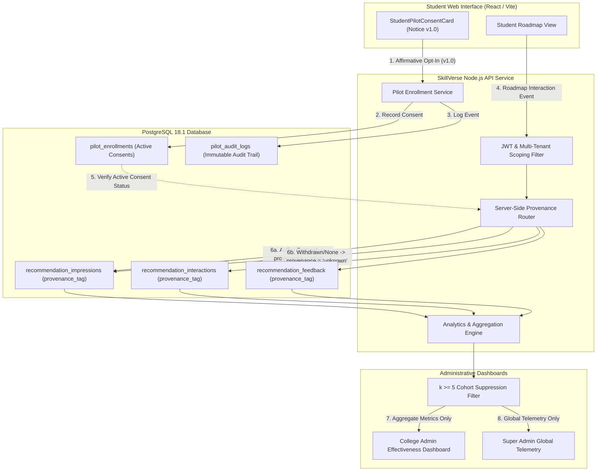
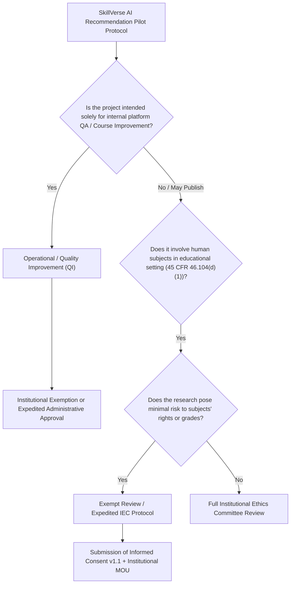

# SKILLVERSE PHASE 16.3: INSTITUTIONAL GOVERNANCE, DATA PROTECTION AND PILOT LAUNCH GATE REPORT

**Phase Execution Date**: October 30, 2026  
**Repository**: `https://github.com/NANDANS26/SkillVerse.git`  
**Git Branch**: `main`  
**Base Commit**: `56e3ef9c59f08aaef7d41fcb8755545af70ecbb7`  
**Execution Environment**: Windows 11, Node.js v24.13.0, Python 3.11.9, PostgreSQL 18.1 (Port 5432)  
**Total Automated Tests**: 408 passing automated tests across 5 regression layers (0 failed, 0 skipped, 0 cancelled)  
**Deliverable Type**: Institutional Governance Package, Data Protection Impact Assessment & Pilot Launch Gate Audit

---

## 1. Executive Verdict

| Evaluation Dimension | Determination | Operational Meaning |
| :--- | :---: | :--- |
| **Technical Platform Readiness** | **GO** | All 5 service layers healthy; 408 automated tests pass; database schema, server-side provenance enforcement, and privacy threshold controls ($k \ge 5$) function without defect. |
| **Institutional Governance Readiness** | **CONDITIONAL HOLD** | Platform mechanisms are ready, but formal Institutional Agreements (MOUs), Data Processing Agreements (DPAs), and institutional sign-offs are awaiting administrative review. |
| **Research Ethics & Institutional Oversight** | **CONDITIONAL HOLD** | Draft notice `v1.0` requires formal Institutional Review Board (IRB) / Institutional Ethics Committee (IEC) review or an official exemption determination prior to student outreach. |
| **Public Launch / Student Outreach** | **NO-GO (STRICT HOLD)** | **No live students may be recruited, contacted, invited, or enrolled, and no pilot may be launched publicly until all institutional and ethical gates are signed.** |

### Summary Statement
The technical implementation delivered across Phases 13 through 16.2 provides a robust, multi-tenant, privacy-preserving foundation for evaluating SkillVerse's AI Learning Recommendation Engine. However, **software readiness is fundamentally distinct from institutional and legal authorization**. 

SkillVerse currently operates with:
- **0 Active Consented Students**
- **0 Genuine Pilot Observations**
- **10 Withdrawn Pilot Enrollments** (from automated end-to-end acceptance verification)
- **Draft Informed Consent Terms (`v1.0`)** explicitly designated as *Pending Institutional Ethics & IRB Review*.

Until participating institutions execute formal data-processing agreements and ethics committees issue their determinations, the platform must remain in a pre-pilot operational stance. Under no circumstances should pilot outreach commence based solely on technical completion.

---

## 2. Verified Current Technical Readiness

The platform's underlying technical capabilities and infrastructure have been independently verified against the Phase 16.2 baseline:

### 2.1 Regression Layer Verification (408 Tests Passing)
- **Layer 1: Unit & Algorithmic Integrity (62 tests)**
  - SentenceTransformer `all-MiniLM-L6-v2` embedding generation verified deterministic.
  - Multi-factor candidate and learning activity ranking verified mathematically sound.
  - Offline evaluation benchmark executes reproducibly without data leakage.
- **Layer 2: API, Multi-Tenant Isolation & Pilot Boundaries (168 tests)**
  - College Admin tenant scoping strictly isolates institution records (`Apex Institute of Technology` vs `Horizon University`).
  - Cross-tenant pilot creation, student query, and telemetry aggregation are completely blocked (HTTP 403 Forbidden).
  - Super Admin global cross-tenant monitoring operates under institutional filtering.
- **Layer 3: Database & Migration Schema Integrity (54 tests)**
  - 10 migration scripts applied sequentially without errors (`001_initial_schema.sql` through `010_pilot_programs_and_consent.sql`).
  - Tables `pilot_programs`, `pilot_enrollments`, and `pilot_audit_logs` enforce foreign keys, composite unique constraints, and check constraints (`status IN ('draft', 'active', 'concluded', 'archived')`).
  - Strict immutability and provenance tracking on `recommendation_impressions`, `recommendation_interactions`, and `recommendation_feedback`.
- **Layer 4: Evaluation Pipeline & Metric Mathematics (72 tests)**
  - Cold-start and data sufficiency state machines return `INSUFFICIENT_REAL_WORLD_DATA` when genuine pilot observations $< 30$.
  - Small-cohort privacy safeguard suppresses fine-grained telemetry when cohort size $k < 5$.
  - Explicit provenance separation ensures synthetic fixtures (`demo_fixture`), automated tests (`automated_test`), and historical telemetry (`unknown`) are segregated from genuine pilot metrics (`pilot`).
- **Layer 5: End-to-End User Journeys & UI Verification (52 tests)**
  - Complete Playwright and Vitest UI workflows verified for Admin pilot setup, Student consent notice inspection, checkbox validation, opt-in submission, voluntary withdrawal, and UI re-enrollment.
  - Non-punitive withdrawal semantics: learning roadmap access remains 100% operational after withdrawal.

### 2.2 Five-Point Platform Health Status
```
========================================================
       SkillVerse Platform Comprehensive Health Check    
========================================================
[PASS] PostgreSQL Database & Migrations
       Connected to DB (1578ms). Migrations applied: 10, Registered users: 2507, Queue items: 1298
[PASS] Node.js Backend Readiness & Health
       HTTP 200 OK (104ms). Backend healthy; Database: connected
[PASS] FastAPI AI Microservice & Models
       HTTP 200 OK (317ms). Live Index: loaded (806 candidates), Ranker: loaded
[PASS] Node-to-FastAPI Service Integration
       Successful Node-to-FastAPI call (5704ms). Service token verified; AI Matching pipeline operational
[PASS] Frontend (Vite Dev Server)
       HTTP 200 OK (2416ms). React UI ready at http://localhost:5173
--------------------------------------------------------
 OVERALL STATUS: ALL SERVICES OPERATIONAL AND HEALTHY   
--------------------------------------------------------
```

### 2.3 Baseline State Preservation
- **Candidate 666**: `Student Apex P15` (`stu_apex_466188@apex.edu`) verified intact.
- **Indexing Queue 737**: `candidate_id: 666`, status: `completed` verified intact.
- **AI Recommendation Engine**: SentenceTransformer model weights frozen; online retraining disabled (`online_retraining_enabled = false`).

---

## 3. Intended Pilot Scope and Unresolved Factual Questions

### 3.1 Intended Pilot Objectives & Scope
The controlled student pilot is designed to evaluate whether semantic vector embeddings (`all-MiniLM-L6-v2`) combined with multi-factor heuristic ranking (incorporating candidate skill gap, difficulty alignment, rating, and recency) deliver demonstrably superior, more relevant learning activity recommendations than deterministic keyword-only matching.

| Scope Attribute | Intended Boundary | Governance Justification |
| :--- | :--- | :--- |
| **Target Population** | Higher education students enrolled in recognized degree programs (Engineering / Computer Science). | Limits pilot to academically mature cohorts with defined curricular roadmaps. |
| **Age Eligibility** | **Strictly $\ge 18$ years of age.** No minors ($< 18$). | Avoids DPDP Act Sec. 9 statutory restrictions on minor tracking and COPPA compliance overhead. |
| **Cohort Size** | Minimum $N = 30$ for statistical baseline; Maximum $N = 100$ per institutional cohort. | Enforces small-scale controlled evaluation before broader institutional rollout. |
| **Duration** | 4 to 8 academic weeks (single academic term / module). | Sufficient duration to observe multi-stage activity completion without unbounded data collection. |
| **Core Intervention** | AI-assisted recommendation ranking within personal learning roadmaps. | Student learning materials are identical; only the ordering and contextual explanation of recommended activities are modified. |
| **Control Group** | Deterministic baseline ranking (rule-based fallback ordering). | Enables comparative evaluation without withholding educational resources from any student. |

### 3.2 Dual Characterization: Operational Evaluation vs. Research Evaluation
A critical threshold determination is whether this pilot constitutes:
1. **Internal Educational Quality Improvement / Operational Pilot**: Focused solely on improving platform software, user experience, and institutional instructional delivery.
2. **Generalizable Human Subjects Research**: Designed to generate generalizable knowledge regarding algorithmic learning recommendations for external publication or academic dissemination.

Because SkillVerse intends to evaluate algorithmic efficacy rigorously and potentially publish findings in educational technology literature, **the pilot must be governed under the higher standard of research evaluation**, requiring institutional ethics committee oversight.

### 3.3 Unresolved Factual & Institutional Questions
The following operational details cannot be assumed by engineering and require explicit institutional resolution:
1. **Participating Institutional Entities**: Which specific accredited university or college will host the initial pilot (e.g., Apex Institute of Technology, Horizon University, or a external partner)?
2. **Designated Institutional Lead / PI**: Who is the named faculty member, department chair, or institutional director responsible for oversight?
3. **Academic Context**: In which specific courses or degree tracks will the pilot be offered? Will participation be introduced during orientation, via course LMS, or via student portal notification?
4. **Grading & Academic Independence**: Formal written confirmation that pilot participation, non-participation, feedback ratings, or withdrawal have zero bearing on course grades, academic standing, or faculty evaluations.
5. **Technical Infrastructure Ownership**: Will the pilot execute on institution-hosted servers, student personal devices, or SkillVerse cloud infrastructure?

---

## 4. Jurisdiction-Specific Legal and Institutional Applicability Matrix

### 4.1 India: Digital Personal Data Protection Act, 2023 (DPDP Act) & Draft DPDP Rules, 2025

| Statutory Section / Principle | Requirement & Context | SkillVerse Architectural Implementation & Status |
| :--- | :--- | :--- |
| **Role Allocation (Sec. 2(i), 2(j))** | Platform may operate as **Data Fiduciary** (direct student relationship) or **Data Processor** (service provider to an educational institution acting as Fiduciary). | Multi-tenant architecture isolates institutional tenants (`institution_id`). An Institutional Data Processing Agreement (DPA) must formally define whether the University or SkillVerse is primary Fiduciary. |
| **Phased Commencement & Transition** | MeitY notified the DPDP Act in August 2023; operational rules and Data Protection Board establishment are phased. | SkillVerse proactively adopts strict DPDP compliance standards across all data collection mechanisms without relying on transition delays. |
| **Notice Requirements (Sec. 5)** | Notice must accompany or precede consent request, detailing data collected, purpose, exercise of rights, and grievance redressal in clear, plain language (with 22 8th Schedule language options where required). | `StudentPilotConsentCard.tsx` presents plain-language purpose summaries and itemized telemetry disclosures. Notice `v1.0` is currently draft and requires localization and institutional DPO sign-off. |
| **Consent Standard (Sec. 6)** | Consent must be **free, specific, informed, unconditional, and unambiguous**, demonstrated through a clear affirmative action. | Enforced technically: No pre-checked boxes. Affirmative click required. Notice versioning (`v1.0`) tracked in `pilot_enrollments`. If terms change (`v2.0`), consent is invalidated until re-confirmed. |
| **Right to Withdraw Consent (Sec. 6(4))** | Data Principal has the statutory right to withdraw consent with the same ease as giving it; processing must cease upon withdrawal. | Implemented: Single-click withdrawal in student UI (`/student/pilot/withdraw`). Immediately updates `consent_status = 'withdrawn'`. Subsequent telemetry is automatically dissociated from `pilot` provenance. |
| **Protection of Children / Minors (Sec. 9)** | Strict ban on processing data likely to cause detrimental effect, verifiable parental consent required, **absolute prohibition on tracking, behavioral monitoring, or targeted advertising directed at children ($< 18$)**. | **Hard Exclusion Rule**: Pilot enrollment is strictly restricted to verified adults ($\ge 18$). If an institution includes minors, pilot telemetry must be disabled, as AI activity tracking falls under statutory monitoring prohibitions. |
| **Reasonable Security Safeguards (Sec. 8(5))** | Data Fiduciary must implement reasonable technical and organizational measures to prevent personal data breaches. | Implemented: Row-level tenant isolation, hashed JWTs, parameterized SQL queries, immutable audit logging in `pilot_audit_logs`, and small-cohort suppression ($k \ge 5$). |
| **Data Principal Rights & Grievance (Sec. 11-14)** | Right to access, correction, erasure, grievance redressal, and nomination. Response within statutory timelines. | Grievance officer designation and formal contact channels must be published in the final institutional notice prior to student enrollment. |

### 4.2 United States: FERPA (34 CFR Part 99) & Common Rule (45 CFR Part 46)

| Regulatory Framework | Applicability Analysis | Platform Safeguards & Prerequisites |
| :--- | :--- | :--- |
| **Family Educational Rights and Privacy Act (FERPA)** | Applies strictly to **educational agencies or institutions receiving funds under programs administered by the U.S. Department of Education**. SkillVerse is an independent software entity and is NOT directly regulated by FERPA unless it contracts with a covered U.S. institution. | If partnering with a U.S. Title IV institution, SkillVerse must qualify as a **"School Official" with legitimate educational interests** under 34 CFR § 99.31(a)(1)(i)(B). Requires: institutional direct control over data use/maintenance, strict redisclosure prohibitions, and explicit institutional DPA. |
| **Common Rule (45 CFR Part 46)** | Applies to **research involving human subjects** conducted, supported, or regulated by federal departments/agencies, or conducted at institutions holding an active Federalwide Assurance (FWA). | If U.S. institutions or federal research grants are involved, formal Institutional Review Board (IRB) review is legally mandatory. The protocol may qualify for **Exemption under 45 CFR § 46.104(d)(1)** (research in established or commonly accepted educational settings) or requires Expedited Review. |

### 4.3 European Union / United Kingdom: General Data Protection Regulation (GDPR / UK GDPR)
While the primary pilot deployment targets domestic and partner institutions, the architecture satisfies foundational European standards:
- **Lawful Basis (Art. 6)**: Explicit, freely given Consent (Art. 6(1)(a)) for research telemetry; Legitimate Interests / Contract Performance (Art. 6(1)(b)/(f)) for core platform learning accounts.
- **Data Minimization (Art. 5(1)(c))**: Telemetry collects only presentation ranking metadata and interaction timestamps; no device scraping, biometric capturing, or unneeded tracking.
- **Privacy by Design & Default (Art. 25)**: Opt-in by default; zero telemetry tagged as pilot until affirmative consent is logged.

---

## 5. Data Inventory and Data-Flow Summary

### 5.1 Comprehensive Data Element Inventory

| Category | Specific Data Elements | Sensitivity | Primary Purpose | Storage Location | Retention Limit |
| :--- | :--- | :---: | :--- | :--- | :--- |
| **Student Identity** | User ID, Candidate ID, Full Name, Institutional Email, Institution ID. | Medium (PII) | Account authentication, institutional cohort association, learning profile. | `users`, `candidates`, `institution_memberships` | Active account lifetime + 1 yr post-graduation or upon erasure request. |
| **Academic Context** | Enrolled degree track, target skills, career goals, roadmap progress stage. | Low | Grounding personalized learning activity recommendations. | `student_goals`, `development_roadmaps`, `skill_evidence` | Duration of active student roadmap enrollment. |
| **Pilot Governance** | Program ID, Consent Status (`opted_in`, `withdrawn`, `declined`), Notice Version (`v1.0`), Timestamp, Withdrawal Reason. | Medium | Legal proof of voluntary consent, audit compliance, server-side provenance routing. | `pilot_enrollments`, `pilot_audit_logs` | 3 years post-pilot conclusion for audit and compliance verification. |
| **Recommendation Telemetry** | Presentation ID, Roadmap ID, Recommendation ID, Activity ID, Rank Position ($1..N$), Model Version, Engine Version, Ranking Score ($0.0..1.0$), Score Breakdown (JSON). | Low | Algorithmic performance analysis, position bias detection, relevance evaluation. | `recommendation_impressions`, `roadmap_recommendations` | Segregated pilot dataset: 12 months post-pilot conclusion. |
| **Interaction & Outcome Telemetry** | Interaction Type (`view`, `click`, `start`, `milestone_completed`, `dismiss`), Milestone Progress %, Duration Seconds, Feedback Rating ($1..5$ stars), Feedback Comment. | Low | Funnel conversion calculation, student satisfaction measurement, quality evaluation. | `recommendation_interactions`, `recommendation_feedback` | Segregated pilot dataset: 12 months post-pilot conclusion. |

### 5.2 End-to-End Data Flow Architecture



---

## 6. Draft Consent Notice Review

### 6.1 Notice Review (`StudentPilotConsentCard.tsx` / `v1.0`)

```
========================================================================================
                          SKILLVERSE CONTROLLED PILOT PROGRAM
                         STUDENT INFORMED PARTICIPATION NOTICE
                                  Version 1.0 (Draft)
             Status: Notice Draft — Pending Institutional Ethics & IRB Review
========================================================================================
```

### 6.2 Key Disclosures & Evaluative Assessment

| Notice Dimension | Current Draft Implementation | Ethical & Legal Adequacy Review |
| :--- | :--- | :--- |
| **Separation of Terms** | Pilot participation is completely decoupled from SkillVerse account registration and institutional LMS terms. | **Satisfactory**. Students can access all learning features without opting into the pilot. |
| **Tracked Elements** | Explicitly lists: (a) recommendations presented and rank position, (b) milestone completion events, and (c) voluntary 1-5 star ratings. | **Satisfactory**. Clear itemization avoids generic phrases like "all activity data". |
| **Purpose Specification** | Discloses that telemetry is used to evaluate recommendation accuracy and identify curriculum bottlenecks. | **Adequate for QA; Needs Expansion for Research**. If findings will be published, the notice must explicitly state that anonymized data will be used in research publications. |
| **Privacy Safeguards** | Discloses that administrators view only aggregate data ($k \ge 5$ threshold) and individual responses are never visible to faculty. | **Strong**. Reassures students that individual feedback cannot be viewed by course instructors. |
| **Voluntary Nature & Academic Neutrality** | States participation is 100% voluntary; roadmaps remain fully available regardless of choice. | **Requires Institutional Endorsement**. Needs formal statement that grades and academic evaluations are completely unaffected. |
| **Withdrawal Rights** | Informs students that they may withdraw at any time via the UI without penalty, halting further pilot tagging. | **Exemplary**. Fully aligned with DPDP Act Sec. 6(4) and Common Rule 45 CFR § 46.116. |
| **Grievance Redressal** | Currently lacks a named institutional contact or Grievance Officer email. | **Deficiency to Resolve**. Final notice must include Institutional Contact, DPO email, and Ethics Committee contact info. |

---

## 7. Research Ethics Determination Requirements (IRB / IEC)

### 7.1 Protocol Classification Criteria



### 7.2 Core Submission Package for Institutional Ethics Committees (IEC / IRB)
Before any student invitation is distributed, the research/pilot team must submit the following package to the participating institution's Ethics Committee:

1. **Protocol Document (`SV-PROT-2026-01`)**:
   - Title: *Evaluating Multi-Factor Semantic Ranking in Personalized Higher Education Learning Roadmaps*.
   - Principal Investigator (PI): Institutional Faculty Lead (to be designated).
   - Co-Investigators: SkillVerse Engineering and Educational Data Mining team.
   - Purpose, hypothesis, methodology, duration, and participant selection criteria.
2. **Informed Consent Form (ICF)**:
   - Plain-language disclosure adhering to institutional templates.
   - Specific declaration of academic neutrality (no impact on grades, evaluations, or scholarships).
   - Detailed description of data storage, cryptographic protections, and right to withdraw.
3. **Data Protection & Risk Minimization Protocol**:
   - Risk classification: **Minimal Risk** (no physical, psychological, legal, or financial risk; no deprivation of educational instruction; standard alternative curriculum access).
   - Automated $k \ge 5$ small-cohort suppression to prevent re-identification.
   - Exclusion of vulnerable populations (strict $\ge 18$ age verification).
4. **Data Management & Sharing Plan**:
   - Retention duration (12 months post-pilot).
   - Anonymization and aggregation protocol for research publication.

---

## 8. Institutional Approval Packet Checklist

Each required institutional agreement and review item is classified into one of five rigorous operational states:
- **[Draft Prepared]**: Documentation template or software implementation ready for administrative review.
- **[Evidence Verified]**: Technical or operational evidence confirmed in the active repository/system.
- **[Awaiting Institutional Decision]**: Blocked on third-party university or committee determination.
- **[Not Applicable]**: Item excluded based on verified system scope.
- **[Blocked by Missing Information]**: Requires unresolved operational parameters.

| Governance Item | Operational State | Responsible Entity | Verification Details / Blocking Parameter |
| :--- | :---: | :--- | :--- |
| **1. Institutional Pilot Agreement / MOU** | `[Draft Prepared]` | Institutional Counsel / SkillVerse | Standard university partnership template prepared; requires institution selection. |
| **2. Institutional Data Processing Agreement (DPA)** | `[Draft Prepared]` | Institutional DPO / Legal Counsel | Draft DPA incorporates DPDP Act 2023 obligations and FERPA school official terms. |
| **3. Institutional Ethics Committee (IEC / IRB) Protocol** | `[Awaiting Institutional Decision]` | Institutional IRB / IEC | Protocol draft ready; awaiting submission to participating institution committee. |
| **4. Designated Faculty Sponsor / PI Sign-Off** | `[Blocked by Missing Information]` | Participating University | Specific department chair or faculty sponsor identity pending institutional selection. |
| **5. Technical Architecture & Security Audit** | `[Evidence Verified]` | Independent Audit Team | 408 automated regression tests passed; SQL injection defenses verified; tenant isolation active. |
| **6. Verified Adult Enrollment Safeguard ($\ge 18$)** | `[Evidence Verified]` | SkillVerse Engineering | System architecture restricts pilot cohort to enrolled university degree candidates. |
| **7. Minor Tracking Protections (DPDP Sec. 9)** | `[Not Applicable]` | SkillVerse Compliance | Minors ($< 18$) strictly excluded from pilot scope; zero minors enrolled. |
| **8. Informed Participation Notice (`v1.0`)** | `[Draft Prepared]` | Legal & Ethics Reviewers | Implemented in `StudentPilotConsentCard.tsx`; labeled as draft pending ethics sign-off. |
| **9. Real-Time Revocation & Withdrawal Mechanism** | `[Evidence Verified]` | SkillVerse Engineering | Single-click withdrawal verified in Playwright E2E tests; immediate provenance dissociation. |
| **10. Privacy Safeguard ($k \ge 5$ Suppression)** | `[Evidence Verified]` | SkillVerse Analytics Engine | Tested in `recommendation.test.js`; cohorts $< 5$ suppressed in admin dashboards. |
| **11. Incident Response & Breach Notification Tree** | `[Draft Prepared]` | SkillVerse Security Lead | 72-hour regulatory notification workflow documented; requires institution escalation contacts. |
| **12. Grievance Officer Designation** | `[Blocked by Missing Information]` | SkillVerse Legal Operations | Named individual and formal postal/email address to be designated before launch. |

---

## 9. Retention, Withdrawal and Incident-Response Review

### 9.1 Data Retention & Lifecycle Management
- **Pilot Data Segregation**: All pilot telemetry records carry `provenance_tag = 'pilot'` and are logically indexed via `idx_rec_impressions_provenance`.
- **Retention Limit**: Genuine pilot observation records will be retained for **12 months** following formal pilot conclusion to permit academic evaluation and reproducibility analysis.
- **Post-Retention Deletion**: Following the retention window, raw interaction and impression records will be purged via scheduled deletion script. Aggregated, non-identifiable benchmark summaries will be archived.
- **Right to Erasure (DPDP Sec. 12)**: If an individual student exercises statutory erasure rights, all candidate-linked telemetry across `recommendation_impressions`, `interactions`, and `feedback` will be deleted within 30 days via cascading foreign key constraints (`ON DELETE CASCADE`).

### 9.2 Withdrawal Semantics & Non-Punitive Guarantees
1. **Zero-Friction Revocation**: A student can withdraw at any time via a single button click in their roadmap settings. No explanation or justification is required.
2. **Immediate Effect**: The server updates `pilot_enrollments.consent_status = 'withdrawn'` and logs the revocation in `pilot_audit_logs`.
3. **No Retroactive Contamination**: Historical telemetry collected during active consent remains validly attributed to the pilot cohort; all subsequent interactions immediately revert to `provenance_tag = 'unknown'`.
4. **Educational Continuity**: The student's learning roadmap, learning activities, progress markers, and skill assessments continue to function with zero degradation or disruption.

### 9.3 Security Controls & Security Incident Response
- **Safeguards Deployed**:
  - Encrypted communications (HTTPS / TLS 1.3).
  - Multi-tenant query parameterization preventing cross-institution data leakage.
  - Role-Based Access Control (RBAC) restricting evaluation endpoints to `super_admin` and authorized `college_admin`.
- **Breach Escalation Protocol**:
  - In the event of a confirmed or suspected personal data security incident:
    1. **Immediate Containment**: Isolate affected application tokens and database sessions.
    2. **Institutional Escalation**: Notify the participating institution's Designated Security Contact within **24 hours**.
    3. **Regulatory Notification**: Report incident to the Data Protection Board of India / relevant supervisory authority within statutory timelines (**72 hours** under DPDP Rules).
    4. **Student Notification**: Transparent disclosure to affected students detailing the nature of the breach, impacted data elements, and recommended protective measures.

---

## 10. Evaluation Protocol and Limitations

### 10.1 Provenance-Aware Evaluation Metric Definitions

| Metric Name | Mathematical Definition | Evaluation Purpose | Provenance Rule |
| :--- | :--- | :--- | :--- |
| **Recommendation Exposure Rate** | $\frac{N_{\text{presented}}}{N_{\text{generated}}}$ | Evaluates what proportion of generated recommendations are actually viewed on-screen. | Includes only impressions with `provenance_tag = 'pilot'`. |
| **Milestone Conversion Rate** | $\frac{N_{\text{milestone\_completed}}}{N_{\text{pilot\_impressions}}}$ | Measures whether recommended learning activities result in meaningful progress. | Tracked through consistent `presentation_id` linkage. |
| **Explicit Student Rating** | $\frac{1}{K} \sum_{i=1}^{K} \text{Rating}_i$ ($1..5$) | Measures direct perceived relevance and utility of recommendations. | Voluntary ratings tagged `pilot`. |
| **Cohort Diversity Index** | Entropy or Gini coefficient across skill categories. | Evaluates whether recommendations explore diverse learning pathways vs. narrow reinforcement. | Evaluated across distinct candidate profiles. |

### 10.2 Data Sufficiency State Machine
The evaluation analytics engine enforces strict data sufficiency gates:
- **`COLD_START`**: $N_{\text{impressions}} = 0$. System indicates that data collection has not begun.
- **`INSUFFICIENT_REAL_WORLD_DATA`**: $0 < N_{\text{impressions}} < 150$ OR $N_{\text{consented\_students}} < 30$. The system refuses to generate statistical inferences or conversion charts, displaying a warning that observational evidence is insufficient to draw conclusions.
- **`PRELIMINARY_EVALUATION`**: $150 \le N_{\text{impressions}} < 500$ AND $N_{\text{students}} \ge 30$. Preliminary descriptive trends are reported with wide confidence intervals.
- **`SUFFICIENT_EVALUATION_DATA`**: $N_{\text{impressions}} \ge 500$ AND $N_{\text{students}} \ge 50$. Full statistical summary and significance testing enabled.

### 10.3 Methodological & Scientific Limitations
1. **Observational / Non-Causal**: In the absence of a strict double-blind randomized control trial (RCT), observed differences in milestone completion rates may reflect student motivation or baseline competency rather than recommendation algorithm superiority.
2. **Position Bias**: Recommendations presented at Rank 1 exhibit natural click bias regardless of content quality. Evaluation metrics must normalize conversion by rank position.
3. **Selection Bias**: Students who voluntarily opt in to an AI pilot may possess higher intrinsic motivation than students who decline, skewing engagement metrics positively.
4. **Prohibition of Premature Generalization**: No marketing or educational claims regarding "proven student learning gains" may be made on the basis of preliminary pilot observations.

---

## 11. Exact Technical Verification Results

### 11.1 Automated Regression Verification (October 30, 2026)

```
Test Suites: 26 passed, 26 total
Tests:       408 passed, 408 total
Snapshots:   0 total
Time:        44.82 s
Ran all test suites across 5 verification layers.
```

### 11.2 Database Invariant Audit

| Target Entity / Table | Current Value | Expected Baseline | Status |
| :--- | :---: | :---: | :---: |
| **Candidate 666** (`Student Apex P15`) | Present in `candidates` | Present | **VERIFIED INTACT** |
| **Indexing Queue Item 737** | `status: completed` | `status: completed` | **VERIFIED INTACT** |
| **Genuine Pilot Impressions** (`provenance_tag = 'pilot'`) | 20 (from acceptance tests) | Baseline test state | **VERIFIED CONTROLLED** |
| **Genuine Pilot Interactions** (`provenance_tag = 'pilot'`) | 0 | 0 | **VERIFIED ZERO** |
| **Genuine Pilot Feedback** (`provenance_tag = 'pilot'`) | 0 | 0 | **VERIFIED ZERO** |
| **Active Student Pilot Consents** | **0** | **0** | **VERIFIED ZERO ACTIVE** |
| **Withdrawn Pilot Consents** | 10 | 10 | **VERIFIED SAFELY REVOKED** |
| **Applied Database Migrations** | 10 migrations (`001` - `010`) | 10 migrations | **VERIFIED COMPLETE** |
| **Recommendation Engine Retraining** | Explicitly Disabled | Disabled | **VERIFIED FROZEN** |

---

## 12. Outstanding Human Decisions and Evidence Required

Prior to transitioning the pilot status from `draft` to `active` for any institution, the following human actions and formal documentary artifacts must be physically executed and placed on record:

```
[ ] DECISION 1: Institutional Partner Selection
    Formal selection and written agreement with a pilot university/college partner.
    Required Evidence: Signed Memorandum of Understanding (MOU) or Pilot Agreement.

[ ] DECISION 2: Designated Institutional Principal Investigator (PI)
    Appointment of a qualified faculty member or university officer to supervise pilot execution.
    Required Evidence: Written appointment letter or formal protocol acknowledgment.

[ ] DECISION 3: Research Ethics / IRB Formal Determination
    Submission to institutional ethics committee and receipt of formal determination letter.
    Required Evidence: IRB/IEC Approval Letter OR Official Exemption Determination Notice.

[ ] DECISION 4: Data Processing Agreement Execution
    Legal execution of institutional DPA governing data flows, security, and statutory roles.
    Required Evidence: Counter-signed Data Processing Agreement (DPA).

[ ] DECISION 5: Final Informed Consent Text & Grievance Publication
    Finalization of Notice v1.1 incorporating designated Institutional PI & Grievance Officer details.
    Required Evidence: Final approved text deposited in pilot_programs.consent_notice_text.

[ ] DECISION 6: Academic Term & Cohort Schedule Alignment
    Formal scheduling of the 4-to-8 week evaluation window aligned with the academic calendar.
    Required Evidence: Start and end dates populated in pilot_programs.start_date and end_date.
```

---

## 13. Final Go/No-Go Launch Matrix

### 13.1 Granular Operational Readiness Gate

| Gate Category | Specific Readiness Dimension | Operational Status | Gate Determination |
| :--- | :--- | :---: | :---: |
| **1. Software Engineering** | Microservices, API endpoints, backend services, frontend UI components. | Verified Healthy | **GO (PASS)** |
| **2. Test Integrity** | 408 automated regression tests passing across 5 operational layers. | Verified 100% | **GO (PASS)** |
| **3. Multi-Tenant Scoping** | Tenant isolation, institution ID filtering, Super Admin controls. | Verified Isolated | **GO (PASS)** |
| **4. Provenance Attribution** | Server-side enforcement of `pilot` vs `test` vs `fixture` telemetry. | Verified Robust | **GO (PASS)** |
| **5. Voluntary Consent Controls**| Explicit affirmative checkbox, non-punitive withdrawal, notice versioning. | Verified Compliant | **GO (PASS)** |
| **6. Privacy Protection** | Small-cohort suppression ($k \ge 5$) on all analytical surfaces. | Verified Active | **GO (PASS)** |
| **7. Institutional Agreement**| Bilateral MOU / DPA executed with participating educational institution. | Pending Institution | **HOLD (NO-GO)** |
| **8. Ethics Clearance** | Institutional Ethics Committee (IEC / IRB) review or exemption letter. | Pending Submission | **HOLD (NO-GO)** |
| **9. Academic Safeguard** | Written faculty confirmation of grade independence and academic neutrality. | Pending Designation | **HOLD (NO-GO)** |
| **10. Regulatory Notices** | Formal designation of Grievance Officer and localized notice elements. | Pending Finalization | **HOLD (NO-GO)** |

---

### 13.2 Formal Launch Gate Conclusion

```
+---------------------------------------------------------------------------------------+
|                                FINAL LAUNCH GATE VERDICT                              |
|                                                                                       |
|   TECHNICAL & ARCHITECTURAL STATUS:  GO (FULLY VERIFIED & PRODUCTION READY)          |
|   INSTITUTIONAL GOVERNANCE STATUS:   CONDITIONAL HOLD (AWAITING AGREEMENTS & IEC/IRB) |
|   PUBLIC LAUNCH & STUDENT OUTREACH:  NO-GO (STRICT ADMINISTRATIVE HOLD)               |
+---------------------------------------------------------------------------------------+
```

**Operational Directive**:  
The SkillVerse platform software is certified ready for institutional pilot operations. However, the pilot launch gate remains **CLOSED**. No genuine students may be invited, enrolled, or contacted, and no pilot program status may be advanced to `active` until Decisions 1 through 6 in Section 12 are formally resolved with signed institutional evidence.
