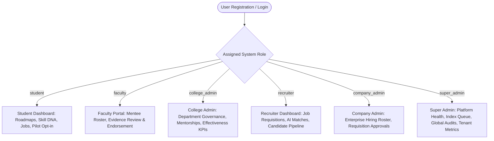
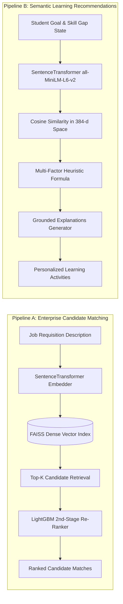
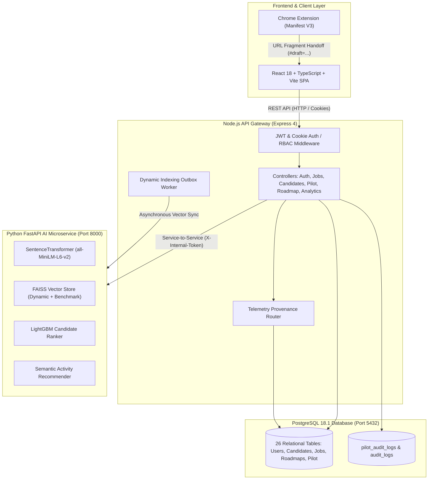

# SkillVerse — Evidence-Aware AI Learning and Workforce Intelligence Platform

[](https://nodejs.org/)
[](https://fastapi.tiangolo.com/)
[](https://www.python.org/)
[](https://www.postgresql.org/)
[](https://react.dev/)
[](https://www.typescriptlang.org/)
[](https://vitejs.dev/)
[](https://huggingface.co/sentence-transformers/all-MiniLM-L6-v2)
[](https://developer.chrome.com/docs/extensions/mv3/intro/)

**Repository**: [`https://github.com/NANDANS26/SkillVerse.git`](https://github.com/NANDANS26/SkillVerse.git)
**Target Branch**: `main`

---

## 1. Project Header & Product Overview

**SkillVerse** is an evidence-aware artificial intelligence learning and workforce intelligence platform. It bridges the critical divide between higher education learning, objective competency verification, and employer talent acquisition.

By replacing unverified keyword self-claims with an evidence-backed **Skill DNA** engine, vector similarity search, multi-factor recommendation intelligence, and controlled pilot telemetry provenance, SkillVerse provides a transparent and verifiable ecosystem for students, university faculty, collegiate administrators, and enterprise hiring teams.

---

## 2. Problem Statement and Vision

Traditional talent discovery and student credentialing systems suffer from structural deficiencies:

1. **Unverified Self-Reporting**: Resumes and digital skill badges rely on unvalidated self-claims, making it difficult for recruiters to ascertain authentic technical ability.
2. **Disconnected Learning Recommendations**: Generic course catalogs recommend activities without grounding them in a student's actual assessed skill gaps, current proficiency, or career goals.
3. **Information Asymmetry in Academia & Industry**: Colleges lack visibility into real-time industry skill demand, while hiring teams lack reliable evidence of student problem-solving capabilities.

### The SkillVerse Vision
SkillVerse connects four core pillars into a unified, evidence-driven loop:

* **Skill DNA**: Mathematical confidence modeling that weights verified assessments, faculty endorsements, and user-initiated repository evidence higher than self-reported claims.
* **Personalized Development Roadmaps**: Career goal alignment that computes deterministic skill gaps and sequences educational activities based on prerequisite urgency.
* **Semantic Recommendation Engine**: Local vector embeddings (`all-MiniLM-L6-v2`) and multi-factor ranking that suggest targeted learning activities with grounded explanations.
* **Workforce Intelligence**: Aggregate analytics that expose genuine supply-and-demand ratios without inflating metrics or compromising student privacy.

> [!NOTE]
> SkillVerse assists learning discovery and competency evaluation; it does not promise or guarantee employment, interview selection, or placement outcomes.

---

## 3. Core Capabilities

| Capability | Implementation Description | Operational Status |
| :--- | :--- | :---: |
| **1. Six-Role Auth & Access Control** | Role-Based Access Control (RBAC) with HttpOnly cookie sessions, Bearer header fallback, and strict tenant boundaries across 6 distinct user roles. | **Production Ready** |
| **2. Skill Profiles & Skill DNA** | Mathematical competency modeling ($C = 1 - \prod(1 - c_i)$) that combines multiple independent evidence items into an objective confidence score. | **Production Ready** |
| **3. Evidence & Faculty Review** | Workflow for students to submit skill evidence and for assigned college faculty to review, verify, or reject submissions with audit logging. | **Production Ready** |
| **4. Personalized Roadmaps** | Dynamic career-goal skill gap analysis classifying skills into `missing`, `growth_needed`, `proficient`, and `requirement_unresolved`. | **Production Ready** |
| **5. Semantic AI Recommendations** | 384-dimensional SentenceTransformer embeddings (`all-MiniLM-L6-v2`) with multi-factor heuristic ranking and explainable rationale generation. | **Production Ready** |
| **6. Candidate / Job Matching** | Two-stage candidate matching utilizing FAISS dense vector retrieval followed by LightGBM machine learning re-ranking. | **Production Ready** |
| **7. Recruiter & Application Flow** | Enterprise job requisition posting, applicant pipeline management, and match score inspection with privacy-masked student records. | **Production Ready** |
| **8. Institutional Administration** | College-level student roster inspection, faculty-student mentorship assignment, and departmental skill analytics. | **Production Ready** |
| **9. Workforce Demand Analytics** | Cross-tenant skill intelligence, canonical skill alias normalization, and labor market supply/demand ratio metrics. | **Production Ready** |
| **10. Browser Extension Evidence Capture**| Manifest V3 Chrome extension for user-initiated GitHub repository metadata capture and secure URL fragment handoff. | **Production Ready** |
| **11. Recommendation Feedback Loop** | Explicit 1–5 star ratings, structured reason tagging, and multi-stage activity conversion tracking (impressions, starts, completions). | **Production Ready** |
| **12. Effectiveness Dashboard** | Institutional recommendation analytics with funnel analysis, date filtering, and small-cohort privacy safeguards ($k \ge 5$). | **Production Ready** |
| **13. Controlled Pilot Foundation** | Administrative pilot program creation, versioned consent notice (`v1.0`), student opt-in, and one-click voluntary withdrawal. | **Production Ready** |
| **14. Server-Controlled Provenance** | Strict server-side attribution tagging (`pilot`, `automated_test`, `demo_fixture`, `unknown`) preventing client spoofing or benchmark pollution. | **Production Ready** |

---

## 4. User Roles and Access Boundaries



### Role Descriptions & Scoping Boundaries
* **Student (`student`)**: Accesses personalized roadmaps, self-reports skills, submits assessment evidence, receives learning recommendations, applies for open jobs, and manages voluntary pilot participation. Cannot access other students' private data or administrative settings.
* **Faculty (`faculty`)**: Views assigned mentees within their collegiate institution, reviews pending skill evidence, verifies or rejects student artifacts, and provides qualitative feedback. Blocked from viewing unassigned students.
* **College Administrator (`college_admin`)**: Oversees institutional academic programs, assigns faculty mentors to students, reviews departmental skill gaps, and accesses the Recommendation Effectiveness Dashboard filtered to their institution. Cannot view corporate hiring pipelines.
* **Company Administrator (`company_admin`)**: Manages enterprise recruiter memberships, oversees corporate job requisitions, and inspects organization-level hiring metrics. Strictly isolated from other companies.
* **Recruiter / HR (`recruiter`)**: Creates company-scoped job listings, executes AI candidate matching, reviews applicant profiles with sanitized faculty notes, and advances applicant interview stages.
* **Super Administrator (`super_admin`)**: Global system oversight, indexing queue management, asynchronous worker monitoring, system health diagnostics, and cross-tenant audit inspection.

---

## 5. AI & Recommendation Architecture

SkillVerse implements two distinct intelligence pipelines:



### 5.1 Learning Activity Recommendation Formula
The learning activity recommendation engine is a **deterministic, manually calibrated multi-factor ranking formula** (not a black-box learning-to-rank model). It ranks candidate activities by scoring:

$$\text{Ranking Score} = w_{\text{sim}} \cdot S_{\text{semantic}} + w_{\text{gap}} \cdot U_{\text{gap}} + w_{\text{payoff}} \cdot P_{\text{payoff}} + w_{\text{diff}} \cdot D_{\text{diff}}$$

Where default production weights are:
* $w_{\text{sim}} = 0.40$ (Semantic relevance between target skill/goal and learning activity metadata)
* $w_{\text{gap}} = 0.30$ (Urgency of the candidate's verified skill deficit)
* $w_{\text{payoff}} = 0.15$ (Potential lift in overall Skill DNA upon verification)
* $w_{\text{diff}} = 0.15$ (Alignment between student current proficiency and activity difficulty level)

If the Python ML service is unreachable, the system executes a deterministic fallback ranking based on prerequisite urgency and activity ratings, ensuring zero platform disruption.

### 5.2 Clarification of Score Semantics
SkillVerse strictly separates these distinct metrics:
* **Semantic Relevance ($[0.0, 1.0]$)**: Cosine vector similarity between text representations in 384-dimensional embedding space.
* **Evidence Confidence ($[0.0, 1.0]$)**: Mathematical confidence derived from evidence type (Assessment: 0.85, Faculty Verified: 0.75, Repository: 0.50, Self-Reported: 0.35).
* **Demonstrated Proficiency ($[0.0, 1.0]$)**: Normalized performance level achieved on verified assessments.
* **Ranking Score ($[0.0, 1.0]$)**: Composite multi-factor score used solely to order recommendation lists.
* **Learning Progress ($[0\%, 100\%]$)**: Student milestone completion along an active learning module.

---

## 6. System Architecture



---

## 7. Technology Stack

### Frontend Application
* **Framework**: React 18.2.0 with TypeScript 5.2.2
* **Build Tooling**: Vite 5.4.8
* **Styling**: Tailwind CSS 3.4.1
* **Icons**: Lucide React 0.309.0
* **Routing**: React Router DOM 6.22.0

### Backend API Services
* **Runtime**: Node.js (v24.13.0 verified / v20+ supported)
* **Web Framework**: Express 4.18.2
* **Database Client**: `pg` 8.11.3 (Connection Pooling)
* **Authentication**: `jsonwebtoken` 9.0.2 & `bcryptjs` 2.4.3
* **CORS**: `cors` 2.8.5

### Artificial Intelligence & Machine Learning
* **Framework**: Python 3.11.9, FastAPI 0.109.0, Uvicorn 0.27.0
* **Vector Embeddings**: `sentence-transformers` 2.3.1 (`all-MiniLM-L6-v2`, 384-d dense vectors)
* **Similarity Search**: `faiss-cpu` 1.7.4
* **Machine Learning**: `lightgbm` 4.3.0, `scikit-learn` 1.4.0, `numpy` 1.26.3

### Database & Persistence
* **RDBMS**: PostgreSQL 18.1 (Port 5432)
* **Schema Evolution**: 10 sequential, versioned migrations (`Backend/migrations/`)
* **Persistence Features**: Cascading foreign keys, composite unique constraints, transactional outbox queue

### Browser Extension
* **Standard**: Google Chrome Extensions Manifest V3
* **Implementation**: Vanilla JavaScript (ES2022), DOM Parser, Chrome Storage API, URL fragment handoff

### Testing & Verification
* **Backend & Component Testing**: Node.js built-in Test Runner (`node:test`, `--test-concurrency=1`)
* **Browser Automation**: Playwright 1.41.2
* **Frontend Linting**: ESLint 9.9.0 with TypeScript ESLint parser
* **Operational Health**: Native Windows PowerShell diagnostic suite (`scripts/dev/health.ps1`)

---

## 8. Repository Structure

```
SkillVerse/
├── Backend/                            # Node.js backend & Python AI microservice
│   ├── app/                            # Python FastAPI application
│   │   ├── api/v1/                     # AI endpoints (match, embed, parse, recommend)
│   │   ├── core/                       # Embeddings, FAISS index, LightGBM ranker
│   │   └── main.py                     # FastAPI server initialization
│   ├── migrations/                     # 10 sequential SQL database migrations
│   ├── models/                         # Baseline FAISS index, metadata, ranker fixtures
│   ├── scripts/                        # Telemetry auditing & offline evaluation utilities
│   ├── src/                            # Express backend source code
│   │   ├── config/                     # Database pool and environment configuration
│   │   ├── controllers/                # Six-role API endpoint handlers
│   │   ├── middleware/                 # JWT cookie auth and tenant scoping filters
│   │   ├── routes/                     # Mounted REST routes
│   │   └── services/                   # Business logic (Roadmap, Pilot, Skill DNA, ML)
│   ├── tests/                          # 38 backend and AI test suites
│   ├── server.js                       # Express application server entrypoint
│   └── package.json                    # Backend dependencies and test scripts
├── BrowserExtension/                   # Manifest V3 Chrome Extension
│   ├── manifest.json                   # Chrome extension manifest
│   ├── popup.html / popup.js           # Extension UI and metadata capture logic
│   ├── src/                            # DOM extractor, URL validator, handoff serializer
│   ├── tests/                          # Extension unit test suite (19 tests)
│   └── README.md                       # Extension developer guide
├── Frontend/                           # React + TypeScript + Vite web client
│   ├── src/                            # UI source code
│   │   ├── components/                 # Reusable components (Effectiveness Dashboard, Pilot)
│   │   ├── contexts/                   # AuthContext, SidebarContext
│   │   ├── pages/                      # Role-specific dashboard views
│   │   ├── services/                   # Axios API client wrapper
│   │   └── router.tsx                  # Client-side protected route definitions
│   ├── tests/                          # Frontend component unit tests (20 tests)
│   ├── vite.config.ts                  # Vite build and dev server configuration
│   └── package.json                    # Frontend dependencies and build scripts
├── audit/                              # Historical audit scripts and manifests
├── scripts/                            # Operational PowerShell automation scripts
│   └── dev/                            # health.ps1, start.ps1, status.ps1, stop.ps1
├── PHASE2_... through PHASE16_3_...    # 35 historical milestone audit reports
├── .env.example                        # Root environment variable template
├── .gitignore                          # Git exclusion rules
└── README.md                           # Master project documentation
```

---

## 9. Local Setup and Installation Guide

### Prerequisites
* Windows 10/11 with **PowerShell 7+** (or Windows PowerShell 5.1)
* **Node.js**: `v20.x` or `v24.x` (LTS recommended)
* **Python**: `3.11.x` 64-bit (added to PATH)
* **PostgreSQL**: `18.x` running on default port `5432` with a database named `skillverse`
* **Google Chrome**: (Optional) for running Playwright tests or the Browser Extension

### Step-by-Step Installation

#### 1. Clone the Repository
```powershell
git clone https://github.com/NANDANS26/SkillVerse.git
cd SkillVerse
```

#### 2. Configure Environment Templates
Copy `.env.example` templates to active `.env` files:
```powershell
Copy-Item .env.example .env
Copy-Item Backend\.env.example Backend\.env
Copy-Item Frontend\.env.example Frontend\.env
```

#### 3. Set Up Node.js Dependencies
```powershell
# Install Backend dependencies
cd Backend
npm install

# Install Frontend dependencies
cd ..\Frontend
npm install

# Install Browser Extension dependencies
cd ..\BrowserExtension
npm install
cd ..
```

#### 4. Set Up Python AI Microservice Virtual Environment
```powershell
cd Backend
python -m venv .venv
.\.venv\Scripts\python.exe -m pip install --upgrade pip
.\.venv\Scripts\python.exe -m pip install fastapi==0.109.0 uvicorn==0.27.0 sentence-transformers==2.3.1 faiss-cpu==1.7.4 lightgbm==4.3.0 scikit-learn==1.4.0 numpy==1.26.3 psycopg2-binary
cd ..
```

#### 5. Initialize PostgreSQL Database & Apply Migrations
Ensure PostgreSQL is active and create the `skillverse` database if not present:
```powershell
# Create database via psql
& "D:\Program Files\PostgreSQL\18\bin\psql.exe" -U postgres -c "CREATE DATABASE skillverse;"

# Execute migrations from Backend
cd Backend
npm run migrate
cd ..
```

#### 6. Start Development Services
You can start all services concurrently using the automated script:
```powershell
.\scripts\dev\start.ps1
```
Or start them in separate PowerShell terminals:
* **Terminal 1 (PostgreSQL)**: Ensure service is running (`pg_ctl` or Windows Service).
* **Terminal 2 (Python AI Service)**:
  ```powershell
  cd Backend
  $env:PYTHONPATH="."
  .\.venv\Scripts\python.exe -m uvicorn app.main:app --host 127.0.0.1 --port 8000
  ```
* **Terminal 3 (Node.js Backend API)**:
  ```powershell
  cd Backend
  npm run dev
  ```
* **Terminal 4 (Frontend Vite UI)**:
  ```powershell
  cd Frontend
  npm run dev
  ```

#### 7. Verify Operational Health
Execute the comprehensive health check probe:
```powershell
powershell -ExecutionPolicy Bypass -File .\scripts\dev\health.ps1
```

#### 8. Stop Services
```powershell
.\scripts\dev\stop.ps1
```

---

## 10. Environment Variables

| Variable Name | Service | Required | Secret? | Description & Safe Placeholder |
| :--- | :---: | :---: | :---: | :--- |
| `NODE_ENV` | Backend | Yes | No | Runtime mode: `development` or `production`. |
| `PORT` | Backend | Yes | No | Backend Express HTTP port (`3000`). |
| `JWT_SECRET` | Backend | Yes | **Yes** | Secret key for signing tokens (`min-32-chars-key`). |
| `PGHOST` | Backend | Yes | No | PostgreSQL host (`127.0.0.1`). |
| `PGPORT` | Backend | Yes | No | PostgreSQL port (`5432`). |
| `PGUSER` | Backend | Yes | No | Database user (`postgres`). |
| `PGPASSWORD` | Backend | No | **Yes** | Database password. |
| `PGDATABASE` | Backend | Yes | No | Database name (`skillverse`). |
| `PGSSL` | Backend | No | No | Enable SSL for cloud DB (`false` locally). |
| `FRONTEND_ORIGIN` | Backend | Yes | No | Allowed CORS origin (`http://localhost:5173`). |
| `ML_SERVICE_URL` | Backend | Yes | No | Python microservice URL (`http://127.0.0.1:8000`). |
| `ML_SERVICE_SECRET` | Backend/AI | Yes | **Yes** | Internal service-to-service auth token (`X-Internal-Token`). |
| `VITE_API_BASE_URL` | Frontend | Yes | No | Backend API endpoint (`http://localhost:3000/api`). |
| `VITE_AI_API_URL` | Frontend | No | No | Direct AI API endpoint (`http://127.0.0.1:8000/api/v1`). |

---

## 11. API Documentation

| Route Group | Base Path | Primary Roles | Key Operations |
| :--- | :--- | :--- | :--- |
| **Authentication** | `/api/auth` | Public / All | `/signup`, `/login`, `/logout`, `/me`, `/check` |
| **Jobs** | `/api/jobs` | Recruiter, Student | Requisition CRUD, candidate job applications |
| **Candidates** | `/api/candidates` | Student, Recruiter | Profile building, AI candidate matching (`mode=live`) |
| **Skills & DNA** | `/api/skills` | Student, Faculty | Skill catalog, evidence submission, faculty reviews |
| **Roadmaps** | `/api/roadmap` | Student, Faculty | Career goals, skill gap analysis, recommendations |
| **Assessments** | `/api/assessments` | Student, Faculty | Assessment catalogs, question submissions, grading |
| **Analytics** | `/api/analytics` | College/Company/Super | Workforce demand, departmental skill distribution |
| **Effectiveness** | `/api/analytics/recommendations` | Super, College Admin | Funnel conversion KPIs, provenance filtering, $k \ge 5$ mask |
| **Pilot Admin** | `/api/pilot` | College, Super Admin | Pilot creation, notice versioning, enrollment auditing |
| **Student Pilot** | `/api/student/pilot` | Student | Participation status, informed opt-in, voluntary withdrawal |
| **AI Matching** | `/api/v1/match` | Internal (Backend) | FAISS + LightGBM candidate matching |
| **AI Recommendations**| `/api/v1/recommend` | Internal (Backend) | SentenceTransformer semantic activity ranking |

---

## 12. Chrome Extension Installation & Metadata Capture

SkillVerse includes an unpacked Manifest V3 browser extension for capturing public GitHub repository evidence.

### Loading Unpacked in Chrome
1. Open Google Chrome and navigate to `chrome://extensions`.
2. Toggle **Developer mode** in the top-right corner.
3. Click **Load unpacked** in the top-left corner.
4. Select the `SkillVerse/BrowserExtension` directory.
5. Pin the **SkillVerse Companion** extension to your browser toolbar.

### User-Initiated Evidence Capture Workflow
1. Navigate to any public repository on GitHub (e.g., `https://github.com/owner/repo`).
2. Click the SkillVerse extension icon in the toolbar.
3. The extension extracts canonical DOM metadata: repository name, owner, description, language tags, license, and stars.
4. Click **Import to SkillVerse**.
5. The extension serializes the draft payload into a secure URL fragment (`http://localhost:5173/extension/import#draft=...`) and opens the SkillVerse platform.
6. The student reviews the imported data and links it to an active Skill DNA competency.

> [!WARNING]
> **Evidence Disclaimer**: Capturing public GitHub repository metadata verifies repository existence and project context. It does not independently prove code authorship, technical proficiency, or proprietary ownership. In SkillVerse, repository artifacts are categorized with a preliminary confidence weight ($0.50$) pending assessment or faculty review.

---

## 13. Testing & Verification

SkillVerse provides a test suite spanning unit, component, API, database, machine learning, and browser end-to-end acceptance tests.

### Running Test Suites

```powershell
# 1. Browser Extension Unit Tests (19 tests)
cd BrowserExtension
npm test
cd ..

# 2. Frontend Component & Unit Tests (20 tests)
cd Frontend
npm test
npm run lint
npm run build
cd ..

# 3. Backend Unit, Integration & Regression Tests (298 tests)
cd Backend
npm test
cd ..

# 4. Python AI & SentenceTransformer Tests
cd Backend
$env:PYTHONPATH="."
.\.venv\Scripts\python.exe tests/test_model_inference.py
.\.venv\Scripts\python.exe tests/test_recommend_activities.py
cd ..
```

---

## 14. Security, Privacy and Pilot Governance

SkillVerse implements rigorous security boundaries:
* **Cookie-Based Authentication**: Session tokens are held in `HttpOnly`, `SameSite=Lax` cookies, protecting against Cross-Site Scripting (XSS) token exfiltration.
* **Tenant Isolation**: Multi-tenant database queries enforce `institution_id` or `company_id` scoping at the SQL layer, preventing cross-tenant data leakage.
* **Internal Service Defense**: The Python AI microservice accepts requests exclusively accompanied by the secret `X-Internal-Token` header.
* **Server-Controlled Telemetry Provenance**: Telemetry records cannot be spoofed by client headers. Records are assigned `provenance_tag = 'pilot'` only when an active, unwithdrawn student consent record exists in `pilot_enrollments`.
* **Small-Cohort Privacy Safeguards ($k \ge 5$)**: The analytics aggregation engine automatically suppresses granular feedback distributions and exact mean ratings whenever an observed cohort is smaller than 5 individuals, mitigating re-identification risks.
* **Voluntary Non-Punitive Withdrawal**: Students can withdraw from pilot programs at any time with a single click. Roadmap access and platform features continue completely unimpeded.

### Controlled Pilot Operational Status
> [!IMPORTANT]
> **Governance Notice**: The controlled pilot participation foundation is fully implemented in software. However, **formal institutional governance approvals, bilateral Data Processing Agreements (DPAs), and Institutional Review Board (IRB) / Institutional Ethics Committee (IEC) determinations remain outstanding. Live student recruitment, outreach, and public pilot launches are currently on administrative hold.**

---

## 15. Known Limitations and Roadmap

### Known Limitations
* **Pilot Data Volume**: The platform reports zero genuine student pilot observations in production; current database telemetry represents controlled automated regression tests and synthetic benchmark fixtures.
* **Algorithmic Scope**: The learning recommendation formula is a deterministic multi-factor model; online retraining from live user feedback is intentionally disabled pending governance authorization.
* **Repository Evidence Verification**: GitHub metadata capture is descriptive; deep AST code analysis and commit authorship verification are planned for subsequent phases.

### Future Roadmap
1. **Institutional Governance Sign-Off**: Execution of university DPAs and Institutional Ethics Committee clearance.
2. **Double-Blind Pilot Evaluation**: 4-to-8 week controlled academic cohort study comparing semantic recommendation ranking against baseline curricula.
3. **Automated Code Artifact Verification**: Sandboxed compilation and test execution for student code repositories.
4. **Enhanced Analytics**: Advanced retention metrics and longitudinal skill-acquisition trajectory modeling.

---

## 16. Contribution and License

### Contributing
Contributions to SkillVerse should follow strict software quality and verification standards:
1. Ensure all changes maintain multi-tenant isolation and role boundaries.
2. Add corresponding automated regression tests under `Backend/tests/` or `Frontend/tests/`.
3. Verify that `scripts/dev/health.ps1` reports 100% operational health across all services.
4. Submit pull requests against the `main` branch with detailed commit descriptions.

### License
**Proprietary / Restricted Access**: This repository currently has **no explicit open-source license**. All rights are reserved by the author. Unauthorized distribution, commercial deployment, or reproduction without written permission is strictly prohibited.
